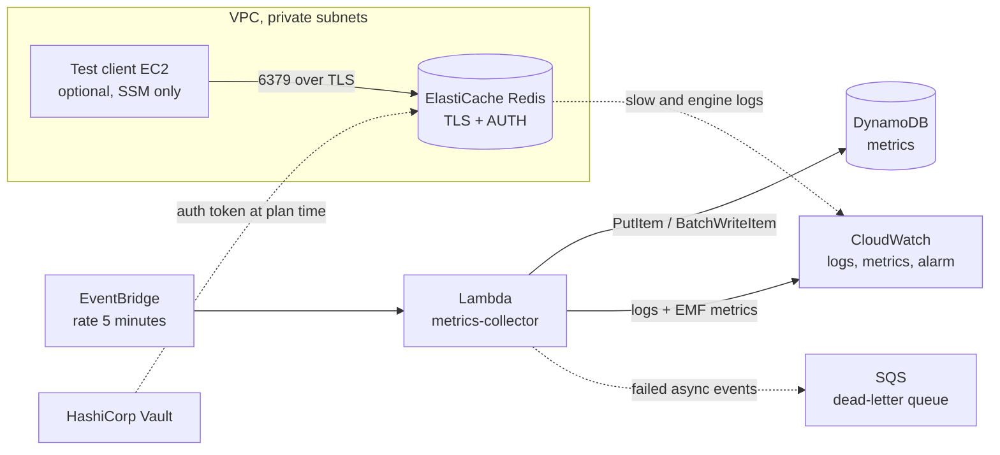

# NeboPetProject B: serverless metrics collector with DynamoDB and Redis

A small AWS project built with Terraform. A scheduled Lambda function checks the availability and latency of a list of URLs, stores the results in DynamoDB and publishes custom CloudWatch metrics. A secured Redis cache (ElastiCache) is provisioned for the caching layer, and secrets are read from HashiCorp Vault.

It covers three DevOps tasks:

| Task | Where |
|---|---|
| Serverless infrastructure | `modules/lambda`, `modules/iam`, `modules/cloudwatch` |
| NoSQL database | `modules/nosql` (DynamoDB) |
| In-memory data solution | `modules/elastic_cache`, `modules/redis_client` |

## Architecture



The collector does not use Redis today. Redis is deployed, secured and tested on its own, ready for a reader function that would cache DynamoDB queries.

## Repository layout

```
.
├── main.tf              providers, Vault data source, module wiring
├── variables.tf         root inputs
├── outputs.tf           names, endpoints, connection string template
└── modules/
    ├── nosql/           DynamoDB table
    ├── iam/             Lambda roles and DynamoDB policies
    ├── lambda/          function, schedule, log group, DLQ, alarm, script.py
    ├── network/         VPC, private subnets, optional public subnet
    ├── cloudwatch/      Redis log groups and alarms
    ├── elastic_cache/   Redis replication group and security group
    └── redis_client/    optional EC2 test host (SSM access only)
```

## Prerequisites

- Terraform 1.0 or newer, AWS CLI v2 and the Session Manager plugin
- An AWS account and credentials (region `eu-west-2` by default)
- A running, unsealed Vault with a `kv-v2` engine mounted at `secret/`
- Deployer permissions for DynamoDB, Lambda, SQS, EventBridge, ElastiCache, EC2, VPC, IAM, CloudWatch and SSM

## Deployment

1. Store the Redis password in Vault (hex avoids characters that Redis AUTH rejects):

   ```bash
   vault kv put secret/pet_2/redis password="$(openssl rand -hex 16)"
   ```

2. Point the Vault provider at your server. Nothing secret is stored in the repository:

   ```bash
   export VAULT_ADDR='https://<vault-host>:8200'
   export VAULT_TOKEN='<token with read access to secret/pet_2/*>'
   export VAULT_CACERT='<path to the certificate>'   # or VAULT_SKIP_VERIFY=true in a lab
   ```

3. Deploy:

   ```bash
   terraform init
   terraform validate
   terraform plan
   terraform apply
   ```

4. Remove everything when done (ElastiCache bills hourly):

   ```bash
   terraform destroy
   ```

### Main inputs

| Variable | Default | Purpose |
|---|---|---|
| `aws_region` | `eu-west-2` | Deployment region |
| `lambda_runtime` | `python3.12` | Lambda runtime |
| `monitor_targets` | one example URL | List of `{name, url}` the collector checks |
| `num_cache_clusters` | `2` | Redis nodes (1 = single node, 2 or more = Multi-AZ failover) |
| `node_type` | `cache.t4g.micro` | Redis instance size |
| `engine_version` | `7.0` | Redis version |
| `snapshot_retention_days` | `7` | Days of daily Redis snapshots (0 disables) |
| `redis_allowed_security_group_ids` | `[]` | Extra client security groups allowed to reach Redis |
| `create_test_client` | `false` | Build the temporary Redis test host |
| `log_retention_days` | `14` | CloudWatch Logs retention |

## 1. Serverless function (Lambda)

### Purpose

`modules/lambda/script.py` is a scheduled availability monitor. On every run it:

1. Reads its configuration from environment variables (`TABLE_NAME`, `TARGETS`).
2. Rounds the EventBridge event time down to the 5-minute interval, which becomes the DynamoDB sort key.
3. Sends an HTTP GET (3 second timeout) to each target and measures latency. Status 200 to 399 counts as up, and a timeout or error counts as down. One failing target never stops the others.
4. Writes one item per target to DynamoDB with a 30-day TTL.
5. Emits custom metrics as CloudWatch Embedded Metric Format lines (`LatencyMs`, `Up`, `TargetsChecked`, `TargetsDown`, `RunDurationMs`, namespace `MetricsCollector`) and one structured JSON log line per target.

If the DynamoDB write fails, the function raises an error so Lambda retries and then sends the event to the dead-letter queue.

### Configuration

| Setting | Value |
|---|---|
| Runtime / handler | `python3.12` / `script.handler` |
| Memory / timeout | 128 MB / 30 seconds |
| Trigger | EventBridge rule, `rate(5 minutes)` |
| Retries | 2 (asynchronous invocation) |
| Dead-letter queue | SQS `metrics-collector-dlq`, encrypted, 14-day retention |
| Logs | `/aws/lambda/metrics-collector`, 14-day retention |
| Alarm | `metrics-collector-errors` fires on one or more errors in 5 minutes |

Design properties: stateless, idempotent (the key is `host` plus the time bucket, so a retry overwrites the same item), minimal memory, and no unnecessary invocations.

### Permissions (least privilege)

| Principal | Allowed | Resource |
|---|---|---|
| Collector role | `dynamodb:PutItem`, `dynamodb:BatchWriteItem` | The `metrics` table only |
| Collector role | `logs:CreateLogStream`, `logs:PutLogEvents` | Its own log group only |
| Collector role | `sqs:SendMessage` | Its own dead-letter queue only |
| EventBridge | `lambda:InvokeFunction` | Only from the schedule rule |

The role cannot read, scan or delete table items. A separate `reader` role with `GetItem` and `Query` exists for a future reader function.

### Testing procedure

```bash
FN=$(terraform output -raw lambda_function_name)
TABLE=$(terraform output -raw dynamodb_table_name)

# 1. Manual run
aws lambda invoke --function-name $FN --region eu-west-2 out.json && cat out.json
# 2. Logs
aws logs tail /aws/lambda/$FN --region eu-west-2 --since 10m
# 3. Data written
aws dynamodb scan --table-name $TABLE --region eu-west-2
# 4. Schedule: repeat the scan after 10 minutes and look for newer "ts" values
# 5. Idempotency: invoke twice with the same time, expect exactly one item
aws lambda invoke --function-name $FN --region eu-west-2 \
  --cli-binary-format raw-in-base64-out --payload '{"time":"2026-10-25T10:03:27Z"}' out.json
# 6. Custom metrics
aws cloudwatch list-metrics --namespace MetricsCollector --region eu-west-2
# 7. Failure path: a bad event goes to the dead-letter queue after the retries
aws lambda invoke --function-name $FN --region eu-west-2 --invocation-type Event \
  --cli-binary-format raw-in-base64-out --payload '{"time":"not-a-date"}' out.json
aws sqs receive-message --queue-url "$(terraform output -raw dead_letter_queue_url)" --region eu-west-2
# 8. Least privilege
aws iam simulate-principal-policy --policy-source-arn <collector role arn> \
  --resource-arns <table arn> \
  --action-names dynamodb:PutItem dynamodb:BatchWriteItem dynamodb:GetItem dynamodb:DeleteItem dynamodb:Scan
```

Expected: step 1 returns `{"checked": 1, "down": 0, ...}`; step 3 shows items for `example`; step 5 returns one item; step 8 allows only `PutItem` and `BatchWriteItem`.

## 2. NoSQL database (DynamoDB)

### Data model

| Attribute | Role | Notes |
|---|---|---|
| `host` | Partition key (string) | The target name, which spreads load across partitions |
| `ts` | Sort key (string) | ISO 8601 UTC time of the 5-minute bucket, sorts chronologically |
| `up`, `status_code`, `latency_ms` | Attributes | Result of the check |
| `expires_at` | TTL attribute (epoch seconds) | Items are deleted about 30 days after creation |

Access pattern: "metrics of one host in a time range", which is a Query on `host` with `ts BETWEEN a AND b`, so no secondary index is needed. A "latest value of every host" screen would need a scan or a global secondary index.

### Configuration

On-demand billing (no idle cost), TTL enabled, point-in-time recovery enabled, server-side encryption with the AWS managed key, deletion protection configurable (`deletion_protection`, off by default for easy teardown).

### Access control

DynamoDB has no network firewall, so access is controlled by IAM. Only the roles listed above can reach the table, and no permission is granted on `*` resources.

### Query examples

```bash
# Write
aws dynamodb put-item --table-name metrics --region eu-west-2 \
  --item '{"host":{"S":"demo"},"ts":{"S":"2026-10-25T10:00:00+00:00"},"up":{"N":"1"}}'
# Read
aws dynamodb get-item --table-name metrics --region eu-west-2 \
  --key '{"host":{"S":"demo"},"ts":{"S":"2026-10-25T10:00:00+00:00"}}'
# Range query
aws dynamodb query --table-name metrics --region eu-west-2 \
  --key-condition-expression "host = :h AND ts BETWEEN :a AND :b" \
  --expression-attribute-values '{":h":{"S":"demo"},":a":{"S":"2026-10-25T00:00:00+00:00"},":b":{"S":"2026-10-26T00:00:00+00:00"}}'
# Update and delete
aws dynamodb update-item --table-name metrics --region eu-west-2 \
  --key '{"host":{"S":"demo"},"ts":{"S":"2026-10-25T10:00:00+00:00"}}' \
  --update-expression "SET up = :v" --expression-attribute-values '{":v":{"N":"0"}}'
aws dynamodb delete-item --table-name metrics --region eu-west-2 \
  --key '{"host":{"S":"demo"},"ts":{"S":"2026-10-25T10:00:00+00:00"}}'
```

These commands use the deployer's credentials. The collector role itself is limited to writes.

## 3. In-memory data (ElastiCache Redis)

### Configuration

| Area | Setting |
|---|---|
| Engine | Redis 7.0, replication group `<owner>-redis` |
| Sizing | `cache.t4g.micro`, 2 nodes with Multi-AZ failover (set `num_cache_clusters = 1` for one node) |
| Network | Private subnets in two availability zones, no public endpoint |
| Access | Security group allows port 6379 only from the client security groups listed |
| Authentication | AUTH token required; the token is read from Vault (`secret/pet_2/redis`, key `password`) |
| Encryption | TLS in transit and encryption at rest |
| Persistence | Daily RDB snapshots (02:00 to 03:00 UTC), kept 7 days |
| Monitoring | Slow log and engine log in CloudWatch Logs; alarms on memory (above 80%) and engine CPU (above 80%) per node; standard ElastiCache metrics such as CacheHits and CacheMisses |

### Connection string (credentials redacted)

```
rediss://:<AUTH_TOKEN>@<primary-endpoint>:6379
```

`terraform output redis_connection_string_template` prints it with the real endpoint. The `rediss://` scheme means TLS.

### Operational procedures

The cache has no public endpoint, so testing uses a temporary host inside the VPC:

1. Set `create_test_client = true` and run `terraform apply`. This adds an internet gateway, a small public subnet and a `t3.micro` host with no inbound rules and SSM-only access.
2. Open a session and run the prepared test (the token is typed silently and is never stored):

   ```bash
   aws ssm start-session --region eu-west-2 \
     --target "$(terraform output -raw redis_test_client_instance_id)"
   redis-smoke-test
   ```

   The token comes from `vault kv get -field=password secret/pet_2/redis`.
3. The test runs `PING`, `SET`, `GET`, `INCR` (twice), `DEL`, shows the hit and miss counters and persistence settings, and runs two negative tests: a plain connection without TLS (must fail) and a TLS connection without a password (must return `NOAUTH`).
4. Persistence and configuration evidence:

   ```bash
   aws elasticache create-snapshot --replication-group-id <owner>-redis --snapshot-name manual-test --region eu-west-2
   aws elasticache describe-replication-groups --replication-group-id <owner>-redis --region eu-west-2
   ```

5. Set `create_test_client = false` and apply, or destroy everything, when finished.

### Use cases

A read-through cache in front of DynamoDB metrics queries, short-lived counters (`INCR`) and rate limits, and sharing latest-value lookups between functions.

## Security summary

- No secrets in the repository. The Redis token lives in Vault and is read at plan time with a read-only identity. Terraform state contains the value, so **never commit state files** (`.gitignore` excludes them) and use an encrypted remote backend for anything beyond a lab.
- Roles follow least privilege and are scoped to individual resources.
- Redis is private, TLS-only and password-protected, and DynamoDB and the dead-letter queue are encrypted.
- The test host has no inbound ports, requires IMDSv2 and has an encrypted disk.

## Cost and cleanup

ElastiCache, the test host and the public subnet's internet gateway bill while they exist. DynamoDB on-demand and Lambda cost almost nothing at this volume. Collect your evidence in a short session, then run `terraform destroy`.

## Known limitations

- The collector does not use Redis and there is no reader API yet. Adding one needs a Lambda inside the VPC, its own security group, `AWSLambdaVPCAccessExecutionRole` and the DynamoDB gateway endpoint (`create_vpc_endpoint = true`).
- AOF persistence is not enabled, and snapshots protect data up to the last snapshot.
- The deployer account in the lab used broad managed policies. A real deployment should use a scoped deployer role.
- Terraform state holds the Redis token (see Security summary).

## Evidence

Add screenshots and terminal output here before submission:

- [ ] Lambda configuration, EventBridge rule and IAM policy
- [ ] Successful invocation and CloudWatch log lines
- [ ] DynamoDB items, TTL, point-in-time recovery and encryption settings
- [ ] Custom metrics in the `MetricsCollector` namespace and the error alarm
- [ ] Dead-letter queue message from the failure test
- [ ] Redis configuration, security group rules and `redis-smoke-test` output
- [ ] Snapshot creation and Redis CloudWatch metrics and alarms
- [ ] `git log` search showing no secrets in history
